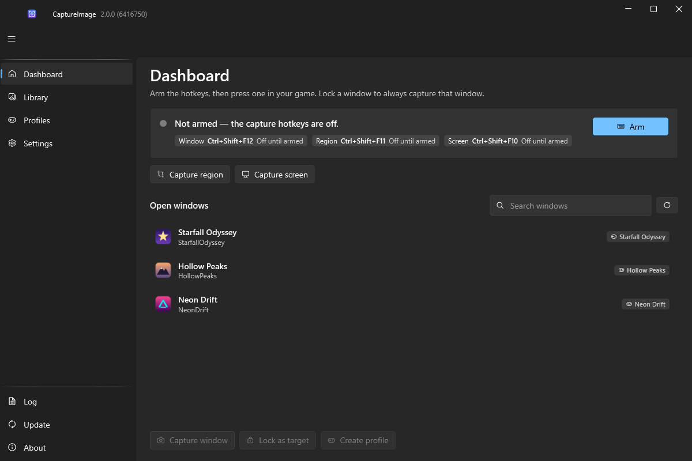
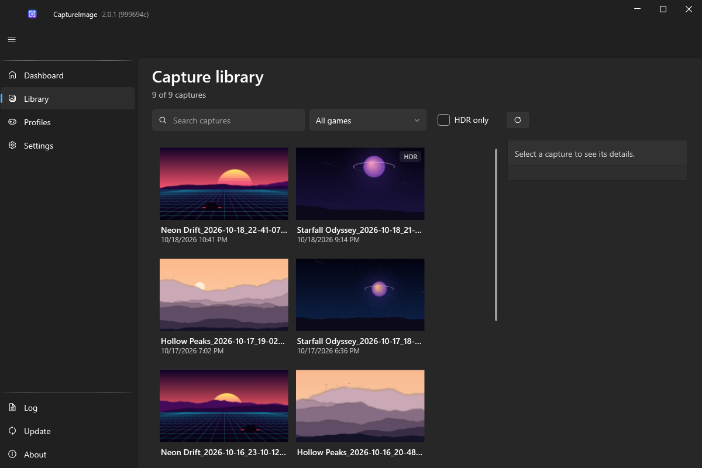
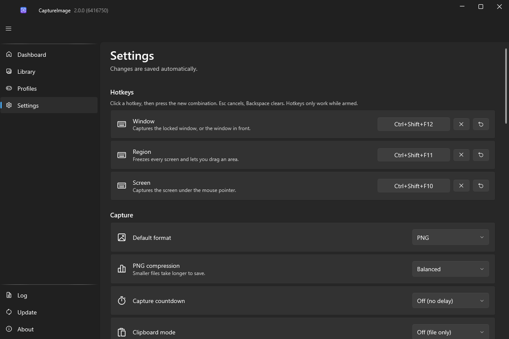
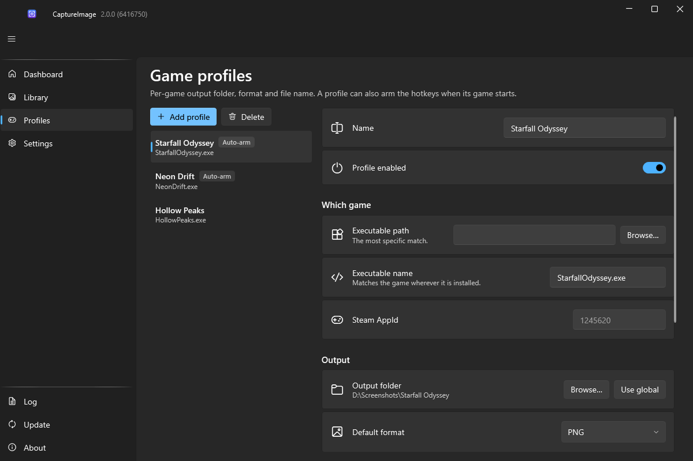
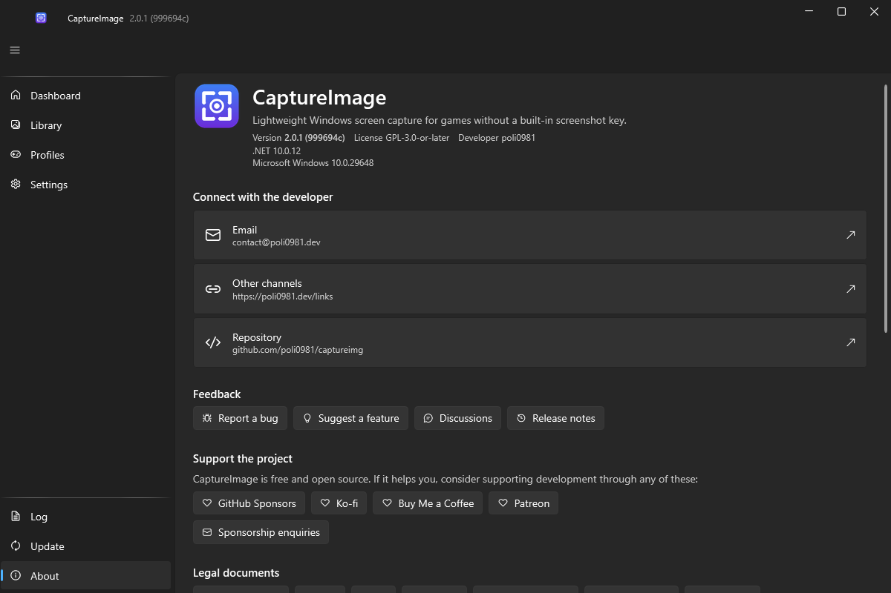
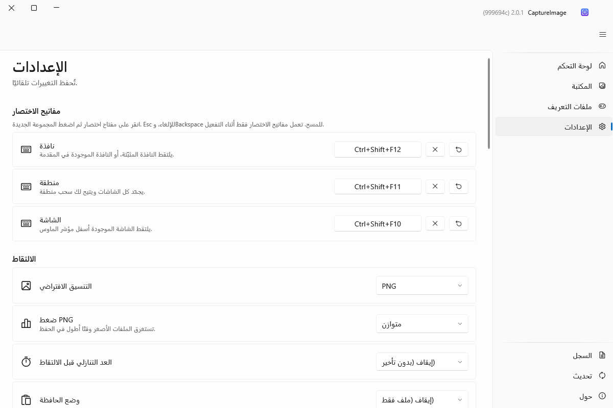

# CaptureImage

[](https://github.com/poli0981/captureimg/actions/workflows/ci.yml)
[](https://github.com/poli0981/captureimg/releases)
[](LICENSE)
[](https://dotnet.microsoft.com/download/dotnet/10.0)
[](https://securityscorecards.dev/viewer/?uri=github.com/poli0981/captureimg)

A lightweight Windows screenshot tool for games that don't have their own screenshot key.
It sits in the tray, stays out of the way, and takes a clean capture when you press a hotkey.

> **In one line:** click **Arm**, press `Ctrl+Shift+F12` in your game, and the PNG is in
> `Pictures\CaptureImage`.

## Why

Many games — older titles, small indie games, emulators, anything outside Steam — have no
screenshot key. Print Screen, the Snipping Tool and the Xbox Game Bar either miss full-screen
DirectX surfaces or pull you out of the game, and OBS or ShareX are a lot of machinery when all you
want is _one frame of one window, now, in a file_.

CaptureImage uses `Windows.Graphics.Capture` — the API behind OBS Studio's window capture — from a
small tray app that does nothing until you press a hotkey.

## Features

- **Three capture modes, three hotkeys**
  - **Window** (`Ctrl+Shift+F12`) — the window in front, or the one you locked on the Dashboard.
  - **Region** (`Ctrl+Shift+F11`) — freezes every screen and lets you drag an area; a click takes
    the whole screen.
  - **Screen** (`Ctrl+Shift+F10`) — the monitor under the mouse pointer.
- **Works on every monitor**, at any scaling, including mixed-DPI setups.
- **HDR** — on HDR displays the full HDR frame is captured and tone-mapped to a normal image; the
  original can be kept as a JPEG XR (`.jxr`) file next to it.
- **Library** — every capture with thumbnails; filter by game or HDR; open, show in folder, copy
  the image or path, extract text (OCR), pin on screen, move to the Recycle Bin.
- **Game profiles** — per-game folder, format, file name and HDR settings, matched by executable
  path, executable name or Steam AppId. A profile can arm the hotkeys and lock the game window as
  soon as the game comes to the front.
- **PNG, JPEG, WebP or TIFF**, with quality / compression settings and a file-name template
  (`{Game}`, `{Process}`, `{Mode}`, date and time, `{counter}`).
- **Optional preview** before saving, countdown (3 / 5 / 10 s), copy to the clipboard, open the
  folder after saving, pin a floating thumbnail.
- **Stays out of your game** — hotkeys are registered only while armed (no keyboard or mouse hook),
  notifications never take focus and never appear in your screenshots, and the app drops to
  Windows' efficiency mode while it idles in the tray.
- **Steam badge** on windows of Steam games (some anti-cheat titles block external capture; Steam's
  own F12 screenshot works there).
- **11 languages** — English, Tiếng Việt, العربية (right to left), 日本語, 简体中文, 한국어, Español,
  Français, Deutsch, Português (Brasil), Русский. Translations are machine-assisted — see
  [`docs/legal/DISCLAIMER.md`](docs/legal/DISCLAIMER.md).
- **Light, dark and high-contrast themes**, following Windows by default.
- **Start with Windows**, start minimized, arm on startup.
- **Private by default** — no telemetry, no account, no cloud. The only network request is the
  update check. See [`docs/legal/PRIVACY.md`](docs/legal/PRIVACY.md).
- **In-app updates** from GitHub Releases (Velopack).

## Screenshots

| Dashboard | Library | Settings |
|:-:|:-:|:-:|
|  |  |  |

| Game profiles | About | Arabic (right to left) |
|:-:|:-:|:-:|
|  |  |  |

## Requirements

- **Windows 11 22H2 or later** (build 22621+), 64-bit.
- **.NET 10 Desktop Runtime** — installed automatically by Setup and by the in-app updater when it
  is missing. The portable zip needs it installed
  ([download](https://dotnet.microsoft.com/download/dotnet/10.0)).

## Install

Download **`CaptureImage-win-Setup.exe`** from the
[latest release](https://github.com/poli0981/captureimg/releases/latest). It installs per user into
`%LocalAppData%\CaptureImage` — no administrator rights, no service. Prefer no installer? Use
**`CaptureImage-win-Portable.zip`**.

Updating from 1.x? Use **Update** inside the app (or run the new Setup). Your settings are copied to
the new data folder and migrated; the old file is left untouched.

### Unsigned installer — SmartScreen

CaptureImage is not code-signed yet, so Windows SmartScreen may say _"Windows protected your PC ·
Unknown publisher"_. Click **More info → Run anyway**. To check the download first, compare its
SHA-256 with `SHA256SUMS.txt` on the release page, or verify the build provenance:

```powershell
Get-FileHash -Algorithm SHA256 .\CaptureImage-win-Setup.exe
gh attestation verify .\CaptureImage-win-Setup.exe --repo poli0981/captureimg
```

## Usage

1. Start CaptureImage. The **Dashboard** shows the hotkeys and every window you can capture.
2. Click **Arm**. While armed the three hotkeys belong to CaptureImage; click **Disarm** (or use the
   tray menu) to give them back. Turn on **Arm when CaptureImage starts** in Settings to skip this
   step.
3. In your game press **`Ctrl+Shift+F12`** (window), **`Ctrl+Shift+F11`** (region) or
   **`Ctrl+Shift+F10`** (screen). Change them in **Settings → Hotkeys**.
4. The image is saved to `Pictures\CaptureImage` (change it in Settings, or per game with a
   profile) and shows up in the **Library**.

Tips:

- **Lock a window** on the Dashboard to capture it even when something else is in front — or let a
  game profile lock it for you.
- **Create profile** on the Dashboard turns the selected game into a profile in one click.
- Closing the window keeps CaptureImage in the tray; quit from the tray menu.
- A game that swallows registered hotkeys (rare) can still be captured with **Capture region** or
  **Capture screen** from the tray menu, optionally with a countdown.
- Settings, logs and the library index are kept in `%LocalAppData%\poli0981\CaptureImage`.
  **Settings → Advanced → Export diagnostics** creates a zip for bug reports (user paths removed).

## Build from source

You need the **.NET 10 SDK** (the exact version is pinned in [`global.json`](global.json)) on
Windows 11.

```bash
git clone https://github.com/poli0981/captureimg.git
cd captureimg
dotnet build CaptureImage.sln -c Release
dotnet test --solution CaptureImage.sln -c Release
dotnet run --project src/CaptureImage.App -c Release -- --data-dir ./.devdata --instance-id dev
```

`--data-dir` and `--instance-id` keep a development copy away from your real settings and from a
copy you have installed. `--smoke-test` opens every page and exits; `--screenshots <dir>` also saves
a PNG of each page.

## Repository layout

```text
src/
  CaptureImage.Core            Capture model, settings and migration, profiles, file naming,
                               HDR tone mapping, the capture coordinator. net10.0, no Windows APIs.
  CaptureImage.Infrastructure  Windows implementations: Windows.Graphics.Capture + Direct3D 11,
                               RegisterHotKey, WinEvent window watcher, displays and HDR, WIC and
                               SkiaSharp encoders, library, settings store, OCR, Velopack, Serilog.
  CaptureImage.ViewModels      View models and the 11-language string resources (no UI framework).
  CaptureImage.UI              WPF + WPF UI: windows, pages, region overlays, toasts, tray icon.
  CaptureImage.App             Entry point: Velopack hooks, single instance, logging, composition.
tests/
  CaptureImage.Core.Tests            Domain logic, migration, coordinator (with fakes).
  CaptureImage.Infrastructure.Tests  Settings store, encoders, Steam, hotkeys, capture on real hardware.
  CaptureImage.ViewModels.Tests      View models and translation completeness.
  CaptureImage.App.UiTests           End-to-end UI tests (FlaUI), run in CI.
docs/                          Architecture, releasing, legal documents, screenshots.
```

See [`docs/ARCHITECTURE.md`](docs/ARCHITECTURE.md) for the design, with diagrams.

## Contributing

Bug reports, translations and pull requests are welcome — see [`CONTRIBUTING.md`](CONTRIBUTING.md).
Native speakers who can proofread a language file are especially appreciated.

## Security

Please report vulnerabilities privately through
[GitHub Security Advisories](https://github.com/poli0981/captureimg/security/advisories/new) or
`security@poli0981.dev`. See [`SECURITY.md`](SECURITY.md).

## Contact

- General: `contact@poli0981.dev`
- Other channels: <https://poli0981.dev/links>
- Collaboration: `collab@poli0981.dev` · Press: `press@poli0981.dev`
- Help and questions: [`SUPPORT.md`](SUPPORT.md)

## AI assistance

CaptureImage is developed with substantial help from an AI coding assistant — Claude (Anthropic),
used through Claude Code — for code, tests and documentation. The maintainer reviews and tests every
change before it ships; commits with meaningful AI authorship carry a `Co-Authored-By` trailer.
Details in [`docs/CONTRIBUTORS.md`](docs/CONTRIBUTORS.md).

## Support the project

CaptureImage is free and developed by one person. If it helps you:
[GitHub Sponsors](https://github.com/sponsors/poli0981) ·
[Ko-fi](https://ko-fi.com/skullmute) ·
[Buy Me a Coffee](https://buymeacoffee.com/skullmute) ·
[Patreon](https://patreon.com/skullmute). For sponsorship enquiries: `sponsor@poli0981.dev`.

## License

[GNU General Public License v3.0 or later](LICENSE) (SPDX: `GPL-3.0-or-later`). Third-party
components and their licenses are listed in
[`docs/legal/THIRD_PARTY_NOTICES.md`](docs/legal/THIRD_PARTY_NOTICES.md).
