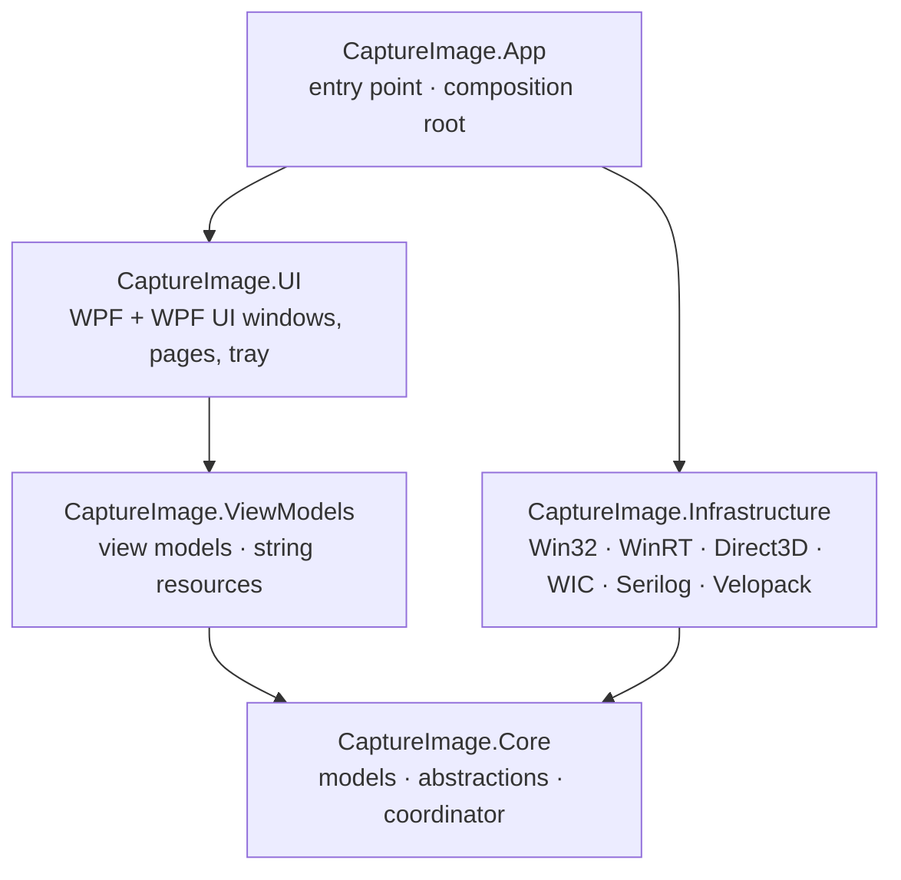
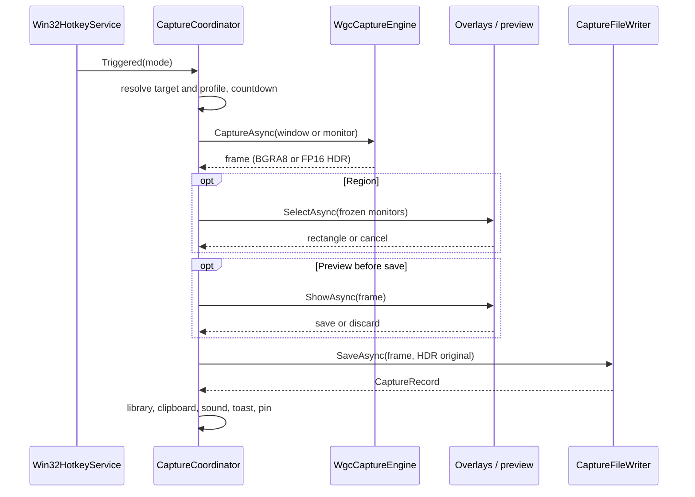
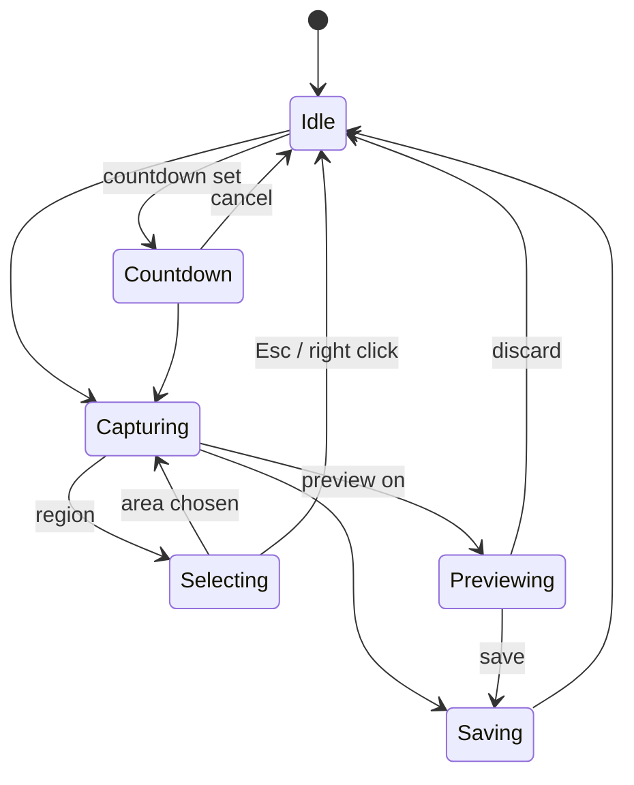
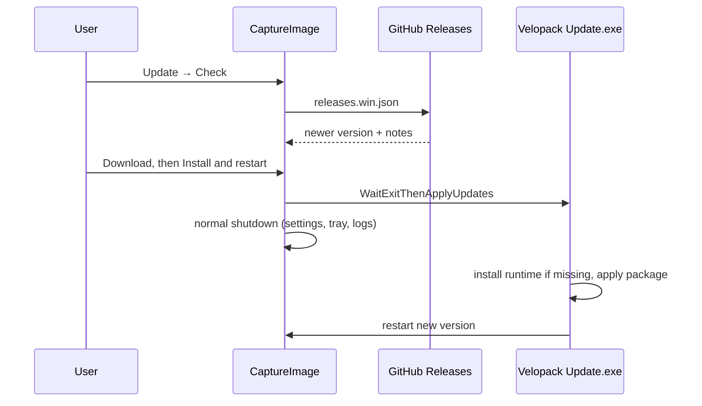

# Architecture

CaptureImage 2.x is a .NET 10 WPF tray app. This page describes how it is put together; the
[README](../README.md) covers what it does.

## Layers

| Project | Target | Rules |
|---|---|---|
| Core | `net10.0` | No Windows APIs, no UI types. Everything Windows-specific is an interface here. |
| Infrastructure | `net10.0-windows10.0.22621.0` | Implements Core interfaces. P/Invoke through CsWin32 (`NativeMethods.txt`). |
| ViewModels | `net10.0` | CommunityToolkit.Mvvm. Talks only to Core abstractions; no WPF, no `Process.Start`, no file I/O. |
| UI | `net10.0-windows10.0.22621.0` | WPF + WPF UI. Implements the interactive abstractions (toasts, overlays, dialogs, clipboard). |
| App | `net10.0-windows10.0.22621.0` | `Main`, Velopack hooks, single instance, logging, dependency injection. |

All services are singletons registered in `CaptureImage.App/Composition/ServiceRegistration.cs`
(Core + Infrastructure) and `CaptureImage.UI/UiServiceCollectionExtensions.cs` (UI, view models,
pages). The container validates the whole graph when it is built.

## Startup and shutdown

1. `VelopackApp.Build().Run()` — install / update / uninstall hooks run before anything else; the
   uninstall hook removes the "Start with Windows" entry.
2. Command line: `--data-dir`, `--instance-id`, `--minimized`, `--smoke-test`, `--screenshots`.
3. Single instance per Windows session, user and instance id: a named mutex plus a
   `CurrentUserOnly` pipe. A second launch asks the first copy to show its window and exits.
4. Serilog: an async rolling file in `<data>\logs` and an in-memory ring buffer for the Logs page;
   user-profile paths are replaced by `%USERPROFILE%`.
5. Settings are loaded (and migrated), the host starts the WinEvent window watcher, and the WPF
   `App` applies language and theme, creates the main window and the tray icon, and arms the
   hotkeys if the user asked for that.
6. On exit the tray icon is removed, the hotkeys are released, the host stops, pending settings are
   written and the log is flushed — including when an update restarts the app.

## Data

Everything the app writes lives in `%LocalAppData%\poli0981\CaptureImage` (or `--data-dir`):

| Path | Content |
|---|---|
| `settings.json` | Settings, schema version 3. Written atomically (temp file + replace); damaged files and files from a newer version are backed up before defaults are used; unknown fields are kept. |
| `library.json` | Index of saved captures (newest first, at most 2,000). |
| `thumbnails\` | JPEG thumbnails for the Library, named by a hash of the image path. |
| `logs\` | `captureimage-<date>.log`, 14 days, 10 MB per file. |

The 1.x settings file (`%LocalAppData%\CaptureImage\settings.json`, inside the Velopack install
folder) is copied on first start and migrated: the old single hotkey goes to the capture mode that
was in use, the other modes get their defaults, and options that no longer exist are dropped.

## Capturing

### Hotkeys and arming

- `Win32HotkeyService` registers one hotkey per capture mode with `RegisterHotKey` (window handle
  `NULL`, `MOD_NOREPEAT`) on its own message-loop thread. Keys are registered **only while armed**,
  because a registered combination never reaches any other application.
- Registration results (registered, conflict, invalid) are shown on the Dashboard and in Settings.
- While the hotkey recorder in Settings is listening, the coordinator suspends the hotkeys so the
  current combination can be pressed again.
- During region selection Esc and Enter are registered temporarily, so they work even when a
  full-screen game keeps the keyboard focus.

### Coordinator

`CaptureCoordinator` (Core) runs one capture at a time; a second request while one is running is
ignored. Every request ends in exactly one outcome — saved, copied, cancelled, discarded, busy or
failed — and failures are always reported with a localized message.

- **Window**: the locked window, otherwise the foreground window. A game profile with auto-arm arms
  the hotkeys (and locks its window) when the game comes to the front.
- **Screen**: the monitor under the mouse pointer.
- **Region**: every monitor is captured first; the overlays show those frozen frames, so the result
  is exactly what was on screen when the key was pressed.

### Windows.Graphics.Capture

- One Direct3D 11 device (hardware, WARP as fallback) is shared by all captures and recreated once
  when the driver reports a lost device.
- Frames are read back through a staging texture; window captures are cropped to the client area
  unless the window frame is wanted, and alpha is forced opaque.
- On an HDR display the frame pool uses `R16G16B16A16Float` (scRGB). `HdrToneMapper` maps it to
  sRGB using the display's SDR white level (knee at 0.8 of white, exponential shoulder), and the
  untouched HDR frame can be saved as JPEG XR.
- Monitors, DPI and HDR state come from `EnumDisplayMonitors`, DXGI (`IDXGIOutput6`) and
  `DisplayConfigGetDeviceInfo`.

### Saving

- PNG (zlib level by "PNG compression"), JPEG and WebP are encoded with SkiaSharp; TIFF and JPEG XR
  with Windows Imaging Component.
- File names come from the template (`FileNameStrategy`): invalid, control and invisible
  formatting characters are replaced, reserved device names are avoided, names are capped at 120
  characters.
- The image is written to a temporary file and moved into place **without overwriting**; on a name
  collision the next counter is tried.

## User interface

- `MainWindow` is a WPF UI `FluentWindow` with a `NavigationView`; pages come from the container
  and only the visible page refreshes in the background (window list, logs, library).
- Strings are bound with `{loc:Tr Key}`, a live binding to the resource service; switching language
  updates every window in place, including right-to-left layout for Arabic. Keys and placeholders
  are checked against all 11 languages by tests.
- Notifications use a snackbar while the main window is in front, otherwise a small topmost window
  that is never activated and is excluded from screen capture (`WDA_EXCLUDEFROMCAPTURE`) — the same
  applies to region overlays, the preview and pinned thumbnails.
- Region overlays are placed over each monitor in physical pixels and show the frozen frame at the
  monitor's DPI, so one image pixel is one screen pixel; the selection is converted back to physical
  pixels.
- The tray icon (H.NotifyIcon) shows a red dot while armed and is re-added after Explorer restarts.
- The main window hides to the tray while it idles and the process then runs in Windows' efficiency
  mode (EcoQoS), lifted during captures.

## Updates

The package id (`CaptureImage`), executable name (`CaptureImage.App.exe`), channel (`win`) and
shortcuts never change, so installed copies keep updating. See [RELEASING.md](RELEASING.md).

## Quality gates

Every pull request runs: build with warnings as errors and the recommended .NET analyzers; unit,
view-model and integration tests with coverage; formatting and SPDX headers; JetBrains InspectCode
(dead and redundant code); vulnerable dependencies and .NET tools, and incompatibly licensed
dependencies; a publish of the app followed by a smoke test that opens every page; end-to-end UI
tests (FlaUI); the SonarQube Cloud quality gate (CI-based analysis with test coverage: no new issues,
at least 80 % coverage on new code outside the WPF shell and the host); PR title; dependency
review; workflow lint (actionlint, zizmor); Markdown lint and link check. CodeQL and OpenSSF
Scorecard run as well.
